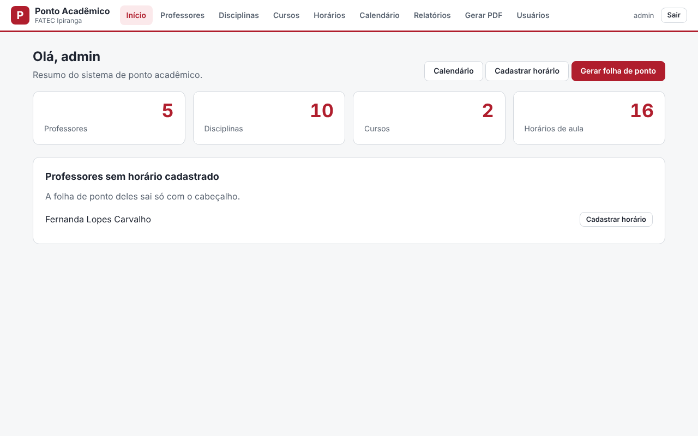

# Ponto Acadêmico — FATEC Ipiranga

Sistema web para **gerar automaticamente a folha de ponto (Anexo I)** dos professores da FATEC a partir do cadastro de cursos, disciplinas, professores e horários de aula.

O sistema preenche o **PDF oficial** (cabeçalho, grade horária semanal e folha de frequência do mês), considerando feriados, faltas, licenças e reposições, e ainda gera um relatório mensal de aulas.



## Funcionalidades

| Área | O que faz |
|------|-----------|
| **Cadastros** | Cursos, disciplinas, professores (com matrícula, regime, categoria, HAE etc.) e horários de aula. |
| **Horários** | Marca vários dias da semana de uma vez, com **prévia do PDF ao vivo** antes de salvar e aviso de conflito de horário. |
| **PDF de ponto** | Preenche o modelo oficial para **qualquer mês/ano**: dias, domingos, aulas por dia, feriados, faltas (FA, FM, LM...) e reposições (R, S, RCD). Gera um PDF, um PDF único com todos ou um `.zip` com um PDF por professor. |
| **Calendário** | Feriados e ocorrências, que saem automaticamente na folha. |
| **Relatório mensal** | Aulas previstas, perdidas, repostas e ministradas, e horas, por professor. Exporta CSV (abre no Excel). |
| **Segurança** | Senhas criptografadas, recuperação de senha por link com validade, login obrigatório, sessão com expiração. |
| **Carga de dados** | Comando `popular_banco` que importa tudo de um arquivo JSON, sem duplicar e validando antes de gravar. |

## Tecnologias

Python 3.12+ · Django 6 · SQLite (padrão) · ReportLab + pypdf (geração do PDF) · HTML/CSS/JS puros (sem frameworks de front-end).

## Instalação

```bash
python -m venv venv
venv\Scripts\activate            # Windows   (Linux/Mac: source venv/bin/activate)
python -m pip install -r requirements.txt
python manage.py migrate
python manage.py runserver
```

Acesse <http://127.0.0.1:8000/>.

**Primeiro usuário** (o banco novo vem vazio):

```bash
python manage.py shell -c "from usuarios.models import Usuario; u = Usuario(username='admin', email='admin@exemplo.com', tipo='admin'); u.definir_senha('troque-esta-senha'); u.save()"
```

> Já usava o sistema antes desta versão? A migração `0007` converte automaticamente as senhas antigas (texto puro) em hash. Basta rodar `python manage.py migrate`.

## Popular o banco com dados

Edite o arquivo `dados_iniciais.json` (o que vem no projeto é um **exemplo fictício**) e rode:

```bash
python manage.py popular_banco
```

- Pode rodar várias vezes: não duplica nada e não altera o que já existe.
- Se houver erro no arquivo, o comando lista **todos** e não grava nada.
- `--arquivo outro.json` usa outro arquivo; `--limpar` apaga cadastros antes (pede confirmação).

Formato do arquivo:

```json
{
  "cursos": ["Análise e Desenvolvimento de Sistemas"],
  "disciplinas": [{"nome": "Banco de Dados", "carga_horaria": 80, "curso": "Análise e Desenvolvimento de Sistemas"}],
  "professores": [{"nome": "Ana Paula Ribeiro", "email": "ana@exemplo.com", "matricula": "100201", "regime_juridico": "CLT", "categoria": "Prof. I"}],
  "horarios": [{"professor": "Ana Paula Ribeiro", "disciplina": "Banco de Dados", "dias": ["Segunda", "Quarta"], "inicio": "19:00", "fim": "20:40", "tipo": "presencial"}]
}
```

## Testes

```bash
python manage.py test
```

São **81 testes**: 42 de lógica (PDF, importador, relatório — não precisam de banco) e 39 de integração com o Django (login, senhas, recuperação de senha, cadastros, calendário, PDF/ZIP, relatório).

## Configuração (variáveis de ambiente)

Sem nenhuma variável o projeto roda em modo de desenvolvimento. Para produção veja [docs/DEPLOY.md](docs/DEPLOY.md).

| Variável | Para que serve | Padrão |
|----------|----------------|--------|
| `DJANGO_SECRET_KEY` | Chave secreta (obrigatória em produção) | chave de desenvolvimento |
| `DJANGO_DEBUG` | `0` desliga o modo debug | `1` |
| `DJANGO_ALLOWED_HOSTS` | Domínios permitidos, separados por vírgula | vazio |
| `DJANGO_CSRF_TRUSTED_ORIGINS` | Origens HTTPS confiáveis | vazio |
| `PONTO_UNIDADE` | Texto que substitui o "xxxxxxxxxx" ao lado de "Unidade:" no PDF | vazio |
| `EMAIL_HOST`, `EMAIL_PORT`, `EMAIL_HOST_USER`, `EMAIL_HOST_PASSWORD` | Envio real de e-mail (recuperação de senha) | e-mails aparecem no terminal |

## Estrutura do projeto

```
Ponto-Academico/
├── manage.py
├── dados_iniciais.json          # exemplo de carga de dados
├── documentos/Modelo de Ponto.pdf   # modelo oficial (Anexo I)
├── sistema_ponto/               # configurações do Django
└── usuarios/
    ├── models.py                # Curso, Disciplina, Professor, HorarioAula, Feriado, Ocorrencia, Usuario
    ├── views.py                 # telas e regras de acesso
    ├── pdf_ponto.py             # ★ gerador do PDF (Python puro, sem Django)
    ├── relatorio.py             # ★ cálculo do relatório e conflitos (Python puro)
    ├── importador.py            # ★ importação do JSON (Python puro)
    ├── management/commands/popular_banco.py
    ├── templates/usuarios/      # telas (base.html + uma por página)
    └── tests/                   # testes automatizados
```

Os módulos marcados com ★ não dependem do Django, então são fáceis de testar e de reaproveitar.

## Como o PDF é gerado

O sistema **não imprime a tela**. Ele abre o PDF oficial e escreve o texto nas coordenadas exatas de cada célula. Para qualquer mês, a tabela de frequência é redesenhada (dias, dias da semana, domingos em cinza). Detalhes em [docs/MODELO_DE_DADOS.md](docs/MODELO_DE_DADOS.md).

## Segurança

- Senhas guardadas com **PBKDF2** (hash do Django); nunca são exibidas.
- Recuperação por **link assinado**, válido por 1 hora e de uso único; o sistema não revela se um e-mail existe.
- Todas as telas (exceto login e recuperação) exigem login; exclusões só por `POST` com proteção CSRF.
- Login renova a sessão (evita fixação de sessão) e expira em 12 horas.
- Apenas administradores gerenciam usuários; ninguém exclui ou rebaixa a si mesmo.

**Limitações conhecidas:** não há bloqueio por excesso de tentativas de login; os perfis são só *administrador* e *funcionário* (funcionários acessam os cadastros).

## Documentação

- [Manual do usuário](docs/MANUAL_DO_USUARIO.md)
- [Modelo de dados e funcionamento do PDF](docs/MODELO_DE_DADOS.md)
- [Publicação (deploy)](docs/DEPLOY.md)
