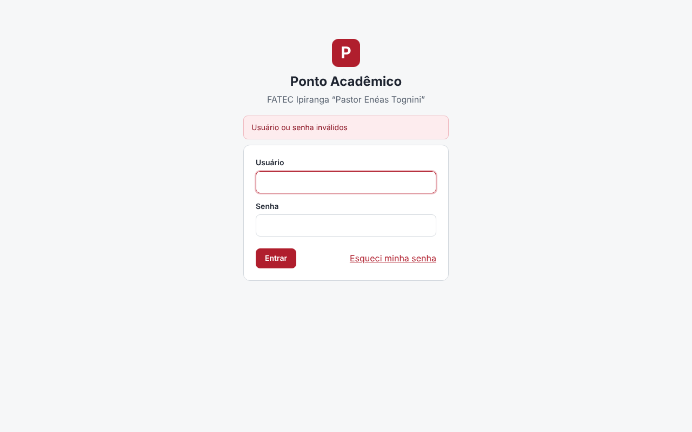
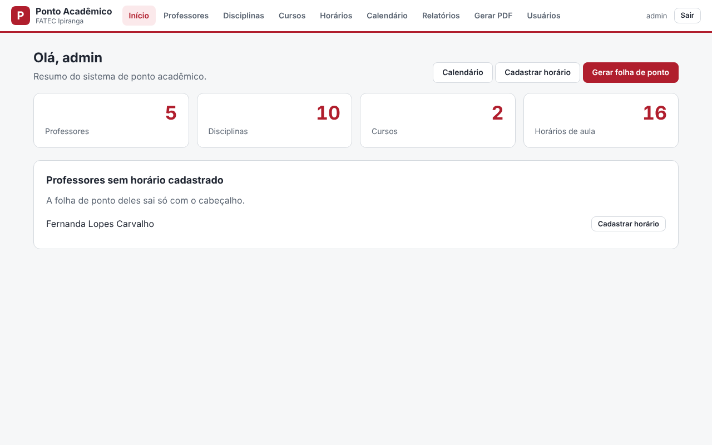
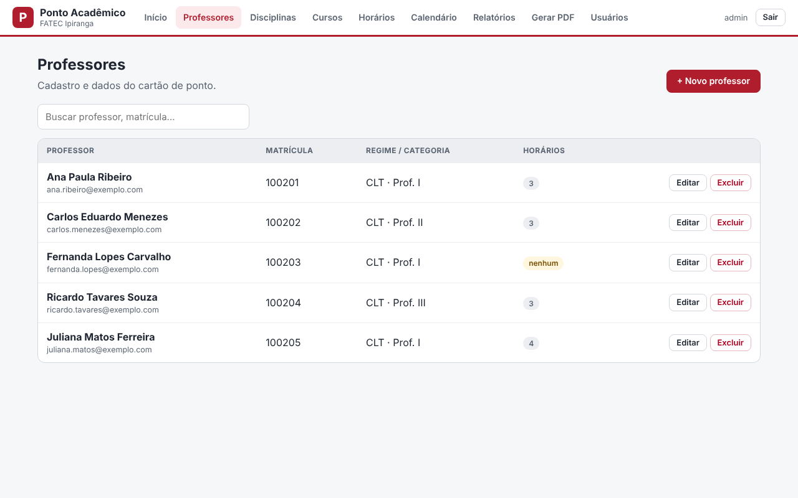
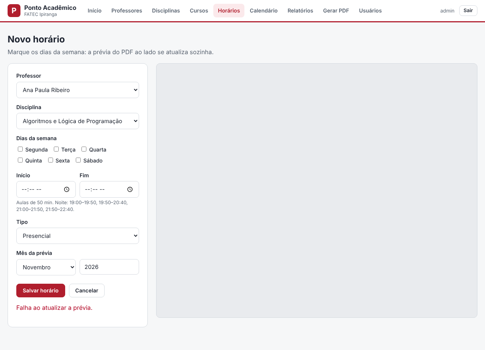
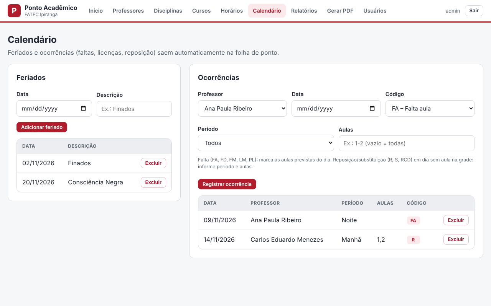
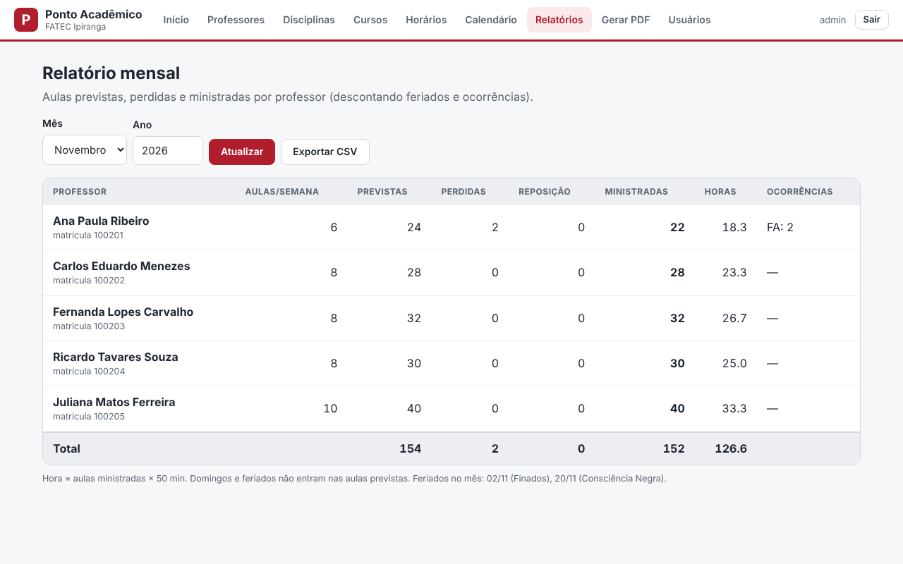
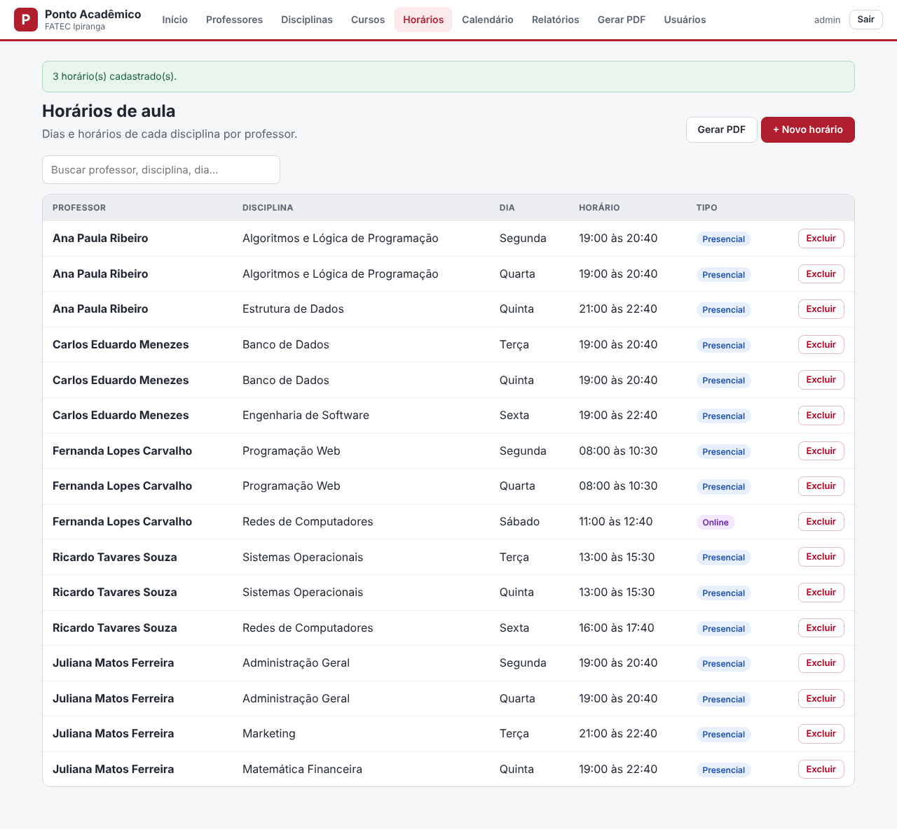

# Manual do usuário

## 1. Entrar no sistema

Acesse o endereço do sistema e informe **usuário** e **senha**.

**Esqueceu a senha?** Clique em *Esqueci minha senha*, informe o e-mail da conta e siga o link recebido (vale por 1 hora e só funciona uma vez). Se não receber o e-mail, peça ao administrador para redefinir a senha em **Usuários → Editar**.

## 2. Tela inicial

Mostra o total de professores, disciplinas, cursos e horários, e avisa **quais professores ainda não têm horário** cadastrado.

O menu superior dá acesso a todas as áreas. Em telas pequenas ele quebra em mais de uma linha.

## 3. Cadastrar os dados (nesta ordem)

1. **Cursos** → *+ Novo curso*.
2. **Disciplinas** → *+ Nova disciplina*: nome, carga horária e curso.
3. **Professores** → *+ Novo professor*. Além de nome e e-mail, preencha os **dados do cartão de ponto** (matrícula, regime jurídico, categoria, hora atividade, HAE-O, HAE-C). Eles saem no cabeçalho do PDF. A *carga horária semanal* pode ficar vazia: o sistema calcula pelas aulas cadastradas.
4. **Horários** → *+ Novo horário* (veja a seção 4).

Nas listas há **busca instantânea** e os botões **Editar** e **Excluir**. Ao excluir um curso, uma disciplina ou um professor, os horários ligados a ele também são excluídos (o sistema pede confirmação).

## 4. Cadastrar horários

Em **Horários → + Novo horário**:

1. Escolha o **professor** e a **disciplina**.
2. Marque os **dias da semana** (Segunda a Sábado). Pode marcar vários de uma vez.
3. Informe **início** e **fim**, e o **tipo** (presencial ou online).
4. Veja a **prévia do PDF** ao lado: ela se atualiza sozinha, mesmo antes de salvar. Use *Mês da prévia* para olhar outro mês.
5. Clique em **Salvar horário**.

**Horários das aulas** (50 min cada). Use horários que coincidam com elas:

| Turno | Aulas |
|-------|-------|
| Manhã | 08:00–08:50 · 08:50–09:40 · 09:40–10:30 · *(intervalo)* · 11:00–11:50 · 11:50–12:40 · 12:40–13:30 |
| Tarde | 13:00–13:50 · 13:50–14:40 · 14:40–15:30 · *(intervalo)* · 16:00–16:50 · 16:50–17:40 · 17:40–18:30 |
| Noite | 19:00–19:50 · 19:50–20:40 · *(intervalo)* · 21:00–21:50 · 21:50–22:40 |

Exemplo: das 19:00 às 20:40 = 1ª e 2ª aulas da noite.

**Avisos:** se o horário cair num intervalo ou fora das aulas, ele não aparece no PDF e o sistema avisa. Se o professor tiver duas disciplinas na mesma aula, aparece um **aviso de conflito** (o horário é salvo mesmo assim, pois pode haver turmas conjuntas).

## 5. Feriados e ocorrências

Em **Calendário**:

- **Feriados**: cadastre a data e a descrição. Nesses dias não há aula e a descrição sai na coluna *Assinatura* da folha.
- **Ocorrências**: escolha professor, data e **código** (FA, FD, FM, LM, CRT, CPE, FAA, FR, PL, R, S, RCD, AN). Opcionalmente informe o **período** e as **aulas** (ex.: `1-2`); vazio significa todas as aulas do dia.
  - Faltas e licenças (FA, FD, FM, LM, PL) trocam a marca das aulas pelo código.
  - **Reposição/substituição** (R, S, RCD) em um dia que não tem aula na grade: informe período e aulas para o sistema marcar.

## 6. Gerar a folha de ponto

Em **Gerar PDF**, escolha o **professor** (ou *Todos os professores*), o **mês** e o **ano**. A prévia aparece sozinha.

- **Baixar PDF**: um arquivo (com todos, se escolheu "Todos").
- **Baixar .zip**: um PDF por professor (aparece ao escolher "Todos").

Em cima do PDF aparecem avisos, quando houver (professor sem horário, ocorrência em dia sem aula etc.). A coluna **Assinatura** fica em branco para o professor assinar à mão.

## 7. Relatório mensal

Em **Relatórios**, escolha o mês e o ano. A tabela mostra, por professor:

| Coluna | Significado |
|--------|-------------|
| Aulas/semana | Aulas da grade semanal |
| Previstas | Aulas da grade no mês, sem domingos e feriados |
| Perdidas | Aulas com FA, FD, FM, LM ou PL |
| Reposição | Aulas extras (R, S, RCD) que não estavam na grade |
| Ministradas | Previstas − perdidas + reposição |
| Horas | Ministradas × 50 min |

Use **Exportar CSV** para abrir no Excel.

## 8. Usuários (administrador)

Em **Usuários** o administrador cria, edita e exclui contas. Ao editar, deixe a senha vazia para mantê-la. Não é possível excluir a si mesmo nem tirar o próprio acesso de administrador.

