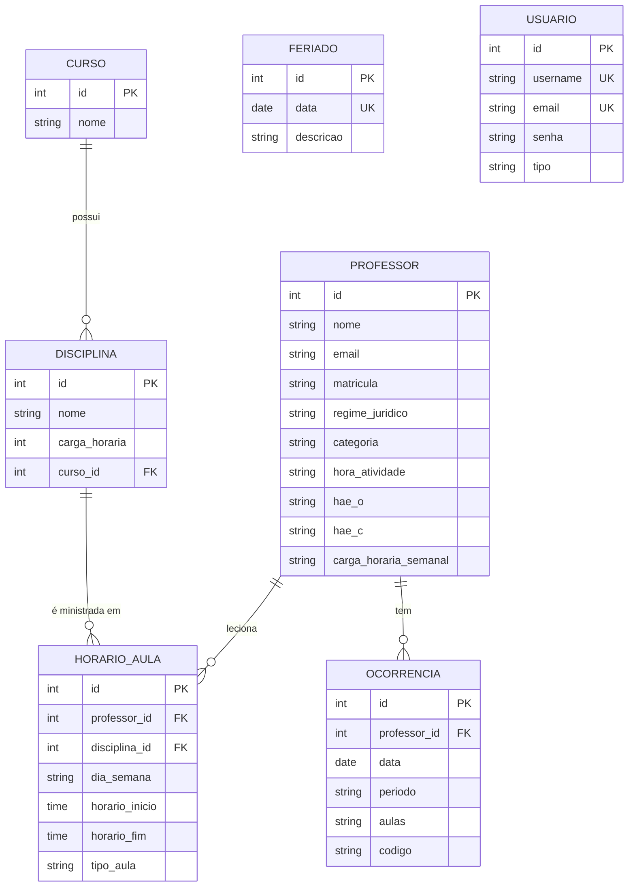
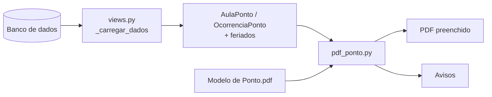

# Modelo de dados e funcionamento do PDF

## Diagrama entidade-relacionamento

`USUARIO` (quem acessa o sistema) é independente de `PROFESSOR` (quem aparece no ponto). `FERIADO` vale para todos os professores.

### Tabelas

| Tabela | Observações |
|--------|-------------|
| **Curso** | Nome do curso. Excluir um curso exclui suas disciplinas e horários. |
| **Disciplina** | `carga_horaria` é o total da disciplina em horas (não é a carga semanal). |
| **Professor** | Campos do cartão de ponto são opcionais. `carga_horaria_semanal` vazia = calculada pelo número de aulas da grade. |
| **HorarioAula** | Uma linha por disciplina + **dia da semana** + intervalo de horário. `tipo_aula`: `presencial` ou `online`. |
| **Feriado** | Data única. Nesses dias o PDF não marca aulas. |
| **Ocorrencia** | `codigo` da legenda do ponto (FA, FD, FM, LM, CRT, CPE, FAA, FR, PL, R, S, RCD, AN). `periodo` (M/T/N ou vazio = todos) e `aulas` (ex.: `1,2`; vazio = todas) limitam o alcance. |
| **Usuario** | `senha` guarda o hash PBKDF2 (nunca o texto). `tipo`: `admin` ou `funcionario`. |

## Aulas e horários

O horário digitado (ex.: 19:00–20:40) é convertido nas aulas do modelo (`usuarios/pdf_ponto.py`, tabela `HORARIOS_AULA`):

| Turno | 1ª | 2ª | 3ª | 4ª | 5ª | 6ª |
|-------|----|----|----|----|----|----|
| Manhã | 08:00 | 08:50 | 09:40 | 11:00 | 11:50 | 12:40 |
| Tarde | 13:00 | 13:50 | 14:40 | 16:00 | 16:50 | 17:40 |
| Noite | 19:00 | 19:50 | 21:00 | 21:50 | — | — |

Cada aula dura 50 min. Uma aula é considerada "dentro" de um slot quando a sobreposição é de pelo menos 25 min. Como a manhã termina às 13:30 e a tarde começa às 13:00, a 6ª aula da manhã e a 1ª da tarde se sobrepõem; nesse trecho vale o slot com **maior sobreposição**, para a mesma aula não ser contada nos dois turnos.

Se a unidade usar outros horários, ajuste somente a tabela `HORARIOS_AULA`.

## Geração do PDF

1. `views.py` lê horários, ocorrências e feriados do mês e os converte em objetos simples.
2. `pdf_ponto.gerar_pdf_ponto` desenha uma **camada transparente** (ReportLab) com todo o texto e a mescla sobre o **PDF oficial** (pypdf). O modelo original não é alterado.
3. Como o modelo traz o mês fixo, a tabela de frequência é **redesenhada**: apaga o corpo antigo, refaz as linhas, os dias, as letras (S T Q Q S S D), as barras cinza dos domingos e o título do mês.
4. Cada aula do dia recebe a **sigla** da disciplina (ex.: *Banco de Dados* → `BD`). Faltas trocam a sigla pelo código; feriados escrevem a descrição na coluna *Assinatura*.
5. O que não puder ser desenhado vira **aviso** (aula fora do modelo, conflito, ocorrência em dia sem aula) e é mostrado na tela.

As posições (em pontos PDF) ficam no início de `pdf_ponto.py` (`GRADE_COLS`, `FREQ_COLS`, `HDR`...). Se o modelo oficial mudar de layout, é só ajustar essa seção.

### Siglas

Geradas do nome da disciplina: ignora *de, da, do, e...*; uma palavra vira as 3 primeiras letras (*Algoritmos* → `ALG`); várias palavras viram as iniciais (*Sistemas Operacionais* → `SO`). Se duas disciplinas do mesmo professor gerarem a mesma sigla, ganham número (`BD`, `BD2`). A lista aparece no campo *DISCIPLINAS* do cabeçalho.

## Relatório

Regras em `usuarios/relatorio.py`: previstas = aulas da grade em cada dia do mês (sem domingos e feriados); perdidas = previstas marcadas com FA, FD, FM, LM ou PL; extras = reposição/substituição (R, S, RCD) fora da grade; ministradas = previstas − perdidas + extras; horas = ministradas × 50 / 60.
